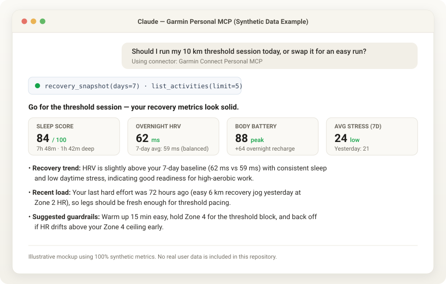

# garmin-personal-mcp

A self-hosted, single-user remote [Model Context Protocol (MCP)](https://modelcontextprotocol.io) server for reading **your own** Garmin Connect data on Cloudflare Workers — designed for Claude (web and mobile) and any other Streamable HTTP + OAuth 2.1 MCP client.

> **Disclaimer:** Not affiliated with or endorsed by Garmin. Garmin and Garmin Connect are trademarks of Garmin Ltd. or its subsidiaries.
>
> **Single-user only:** Garmin's Personal API is strictly for accessing your own data, not for operating a multi-user or hosted SaaS service. Each person deploys their own Worker with their own Garmin Personal API key and GitHub OAuth App.



## Why this server?

- **Remote & works on mobile:** Runs on Cloudflare Workers (Free tier suffices) over **Streamable HTTP** (`createMcpHandler`), so it works from `claude.ai` on desktop and the Claude mobile app.
- **Official Garmin Personal API:** Uses Garmin's official read-only Personal API (`personal.connectapi.garmin.com`) — no reverse-engineered logins, session scraping, or unofficial libraries.
- **Locked down to one user:** Wrapped with `@cloudflare/workers-oauth-provider` (OAuth 2.1 + PKCE `S256` + Dynamic Client Registration + Client ID Metadata Documents) delegating sign-in to GitHub OAuth with a **fail-closed single-user allowlist** (`ALLOWED_GITHUB_LOGIN`).
- **Private & context-friendly by design:** Zero analytics, zero telemetry, zero logging of Garmin tokens or health payloads. Responses automatically strip personal and hardware identifiers (full name, display name, Garmin owner/profile IDs, profile image URLs, device IDs, and exact start/end GPS coordinates), trim unused fields and raw per-minute arrays, include an explicit `units` map and ready-made pace strings on activities, and normalize unworn sleep nights and Garmin's `-1` no-data stress sentinels to `{ date, recorded: false }`.

---

## Prerequisites

1. **A Cloudflare account** — the Free tier is sufficient (Workers + Workers KV).
2. **A GitHub account** — used to authenticate yourself during OAuth sign-in.
3. **A Garmin Connect Personal API key:**
   1. Sign in to [connect.garmin.com](https://connect.garmin.com).
   2. Open your **Profile & Account** menu → **Account Settings**.
   3. Open the **Personal API Key** section and click **Create Key**.
   4. Accept the terms, pick an expiration period, and click **Create**.
   5. Copy the key immediately — Garmin only displays it once.

---

## Deploy

### Option A: One-click Deploy to Cloudflare

[](https://deploy.workers.cloudflare.com/?url=https://github.com/cheehongloong/garmin-personal-mcp)

1. Click the button above to clone the repo into your GitHub account, provision the `OAUTH_KV` Workers KV namespace, and deploy your Worker (`https://garmin-personal-mcp.<your-subdomain>.workers.dev`).
2. Continue to [Create a GitHub OAuth App](#create-a-github-oauth-app) and [Configure secrets and vars](#configure-secrets-and-vars) below.

### Option B: Manual deploy with Wrangler

Requires **Node.js 24+** and **Yarn 4** (`corepack enable`).

```sh
git clone https://github.com/cheehongloong/garmin-personal-mcp.git
cd garmin-personal-mcp
corepack enable
yarn install
yarn wrangler login
```

Create a KV namespace for OAuth state and Garmin bearer-token caching:

```sh
yarn wrangler kv namespace create OAUTH_KV
```

Update `wrangler.jsonc` with:
- Your new `OAUTH_KV` namespace `id`
- `ALLOWED_GITHUB_LOGIN`: your exact GitHub username (the Worker fails closed if empty)
- `TIMEZONE`: your IANA timezone (e.g. `"America/New_York"`, `"Europe/London"`, `"Asia/Tokyo"`) so "today" and 7-day defaults match your local calendar

Deploy:

```sh
yarn deploy
```

Note the deployed Worker URL printed by Wrangler, e.g. `https://garmin-personal-mcp.<your-subdomain>.workers.dev`.

---

## Create a GitHub OAuth App

1. Go to **GitHub Settings → Developer settings → OAuth Apps → New OAuth App** ([github.com/settings/developers](https://github.com/settings/developers)).
2. Fill in the exact URLs for your Worker:
   - **Application name:** `garmin-personal-mcp` (or anything you like)
   - **Homepage URL:** `https://<worker-name>.<your-subdomain>.workers.dev`
   - **Authorization callback URL:** `https://<worker-name>.<your-subdomain>.workers.dev/callback`
3. Click **Register application**, then click **Generate a new client secret**.
4. Copy the **Client ID** and **Client Secret**.

*(For local development with `yarn dev`, create a separate OAuth App with Homepage URL `http://localhost:8787` and Authorization callback URL `http://localhost:8787/callback`.)*

---

## Configure secrets and vars

### Secrets

Set these in the Cloudflare Dashboard (**Workers & Pages → `garmin-personal-mcp` → Settings → Variables and Secrets**) or with Wrangler:

```sh
yarn wrangler secret put GARMIN_PERSONAL_API_KEY
yarn wrangler secret put GITHUB_CLIENT_ID
yarn wrangler secret put GITHUB_CLIENT_SECRET

# Generate a 32-byte random hex key for remembering consent across browser sessions:
openssl rand -hex 32
yarn wrangler secret put COOKIE_ENCRYPTION_KEY
```

### Vars (`wrangler.jsonc` or Cloudflare Dashboard)

| Variable | Required | Default | Description |
|---|---|---|---|
| `ALLOWED_GITHUB_LOGIN` | **Yes** | `""` | Exact single GitHub username allowed to authorize. **Fails closed (`503`/`403`) if unset or invalid.** |
| `TIMEZONE` | No | `"UTC"` | IANA timezone used for "today" and default 7-day ranges (Workers run in UTC). |
| `GARMIN_BASE_URL` | No | `https://personal.connectapi.garmin.com` | Official Garmin Personal API base URL. |
| `MCP_RESOURCE` | No | Derived from request origin | Optional override for the canonical RFC 9728 MCP resource URL (defaults to `https://<host>/mcp`). |

If you used the **Deploy to Cloudflare** button, set `ALLOWED_GITHUB_LOGIN` and `TIMEZONE` under **Settings → Variables and Secrets** (or commit them in your forked repo's `wrangler.jsonc`) and redeploy.

---

## Add to claude.ai (web & mobile)

### On web (`claude.ai`)

1. Open [claude.ai](https://claude.ai) → **Settings → Connectors** (or **Customize → Connectors**).
2. Click **Add custom connector**.
3. Enter your remote MCP URL:
   ```text
   https://<worker-name>.<your-subdomain>.workers.dev/mcp
   ```
4. Leave the OAuth client fields on automatic registration (Dynamic Client Registration / CIMD are both enabled).
5. Click **Connect** → review the consent screen → click **Continue with GitHub** and sign in with your allowlisted GitHub account.

### On mobile (Claude iOS / Android app)

Custom connectors added on `claude.ai` sync automatically to the Claude mobile app on the same account. Open a new chat on your phone, ensure the **Garmin Connect Personal MCP** connector is enabled in the chat's tools/connectors menu, and ask about your training or recovery.

*(Because this server implements standard MCP Streamable HTTP + OAuth 2.1 + PKCE + DCR + CIMD, it also works with other compatible remote MCP clients such as MCP Inspector or Gemini Custom Apps where available.)*

---

## Available tools

All 14 tools are strictly **read-only**. Range tools default to the last 7 days ending today in `TIMEZONE`. Dates use `YYYY-MM-DD`.

| Tool | Description |
|---|---|
| `list_activities` | List activities newest first (`limit` 1–100, `start`, optional `start_date`, `end_date`, `activity_type`, `activity_sub_type`). |
| `get_activity` | Full summary for one activity by `activity_id` (distance, time, pace, HR, cadence, training effect). |
| `get_activity_splits` | Laps/splits and workout steps for one activity. |
| `get_sleep` | Detailed sleep for one night (stages, score, duration). Defaults to today. |
| `get_sleep_range` | Daily sleep summaries across a date range (default last 7 days). |
| `get_hrv` | Daily HRV summaries across a date range (default last 7 days). |
| `get_body_battery` | Daily Body Battery reports across a date range (default last 7 days). |
| `get_stress` | Daily stress stats across a date range (default last 7 days). |
| `get_daily_summaries` | Daily steps, calories, resting HR, and intensity minutes (default last 7 days). |
| `get_heart_rate_day` | All-day heart rate curve and resting HR for one date (default today). |
| `get_heart_rate_zones` | Your configured Garmin heart rate zones. |
| `get_fitness_age` | Garmin fitness age for a date (default today). |
| `get_profile` | Profile settings (units, sleep schedule, etc.). |
| `recovery_snapshot` | Parallel fetch of sleep summaries, HRV, Body Battery, and stress for the last `days` (default 7). |

### Example prompts

- *"Check my recovery snapshot for the last 7 days — should I do intervals today or take an easy run?"*
- *"List my last 10 running activities and compare my pace and average HR on my longest run."*
- *"Pull the splits from my latest workout and show how evenly I paced each lap."*
- *"How has my resting heart rate and sleep duration trended over the last 14 days?"*

---

## Maintenance: rotating keys, revoking access, and deleting

### Rotate your Garmin Personal API key

1. Delete the old key and create a new one in Garmin Connect (**Account Settings → Personal API Key**).
2. Update the Worker secret:
   ```sh
   yarn wrangler secret put GARMIN_PERSONAL_API_KEY
   ```
3. Cached Garmin bearer tokens in KV are bound to a hash of the API key and invalidate automatically on the next request. To clear the cached entry immediately:
   ```sh
   yarn wrangler kv key delete --binding OAUTH_KV --remote garmin:bearer_token
   ```

### Revoke MCP access

1. In `claude.ai` → **Settings → Connectors**, disconnect or remove the custom connector.
2. To revoke all active OAuth tokens and grants server-side, delete the `grant:*` / `token:*` / `client:*` entries in your `OAUTH_KV` namespace (or delete and recreate the KV namespace).
3. In GitHub **Settings → Applications → Authorized OAuth Apps**, revoke your `garmin-personal-mcp` OAuth App.

### Delete the deployment

```sh
yarn wrangler delete
```

Then delete the `OAUTH_KV` namespace in the Cloudflare Dashboard (**Storage & Databases → KV**), delete your GitHub OAuth App, and optionally delete your Garmin Personal API key.

---

## Local development

```sh
cp .dev.vars.example .dev.vars
# Fill in your dev GitHub OAuth App credentials, COOKIE_ENCRYPTION_KEY,
# ALLOWED_GITHUB_LOGIN, TIMEZONE, and GARMIN_PERSONAL_API_KEY.

yarn dev
```

Run checks:

```sh
yarn typecheck
yarn lint
yarn test
```

Connect [MCP Inspector](https://github.com/modelcontextprotocol/inspector) to `http://localhost:8787/mcp` (Streamable HTTP) to test OAuth and tools locally.

---

## Limitations

- **Read-only:** Garmin's Personal API does not support creating workouts, modifying activities, or writing data.
- **Single user:** Built strictly for one owner per deployment (`ALLOWED_GITHUB_LOGIN`). Do not expose a shared multi-user instance on a Personal API key.
- **No activity weather tool:** `get_activity_weather` (`/activity-service/activity/{id}/weather`) was tested against the Garmin Personal API and consistently returned `404 NOT_FOUND` even on outdoor GPS runs, so it is omitted.
- **Garmin rate limits & key expiry:** Subject to Garmin Personal API rate limits and the key expiration period you chose when creating the key. Bearer tokens (valid up to 24h) are cached in Workers KV and reused while >1 hour remains, minimizing token endpoint traffic.

## License

[MIT](LICENSE)
